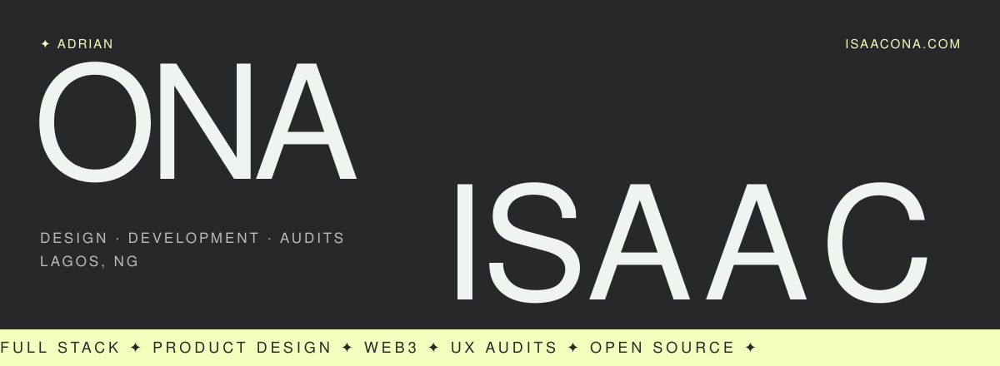

 

> *"Sharp interfaces, clean code, and honest audits; built to move your business forward."*

I'm Adrian, a full-stack engineer and product designer based in Lagos. I close the gap between how things look and how they work. I ship web and mobile products that look right, work right and perform right, and I'm building more and more in Web3.

  
  
  
  
  

| 7+ | 20+ | Lagos, NG | Open |
|:--|:--|:--|:--|
| years experience | projects shipped | based in | availability |

 

01

## Open Source

| Repo | Contribution | Status |
|:--|:--|:--|
| **rsk-cli** | EAS attestation commands: create, verify, revoke, list, schema | [Merged · Feb 2026](https://github.com/rsksmart/rsk-cli/pull/287) |
| **rsk-mcp-server** | Attestation tools with Zod validation and `eth_getLogs` listing | [Merged · Mar 2026](https://github.com/rsksmart/rsk-mcp-server/pull/81) |
| **rsk-cli** | `--write` support for contract calls | [In review](https://github.com/rsksmart/rsk-cli/pull/297) |

 

02

## Selected Work

| | Project | Year | |
|:--|:--|:--|:--|
| 01 | **Letter** | 2024 | [Case study](https://www.isaacona.com/projects/project1) ✦ [Live](https://letter.co/) |
| 02 | **Proto Clothes Rail** | 2022 | [Case study](https://www.isaacona.com/projects/project2) ✦ [Live](https://proto-objects.com/) |
| 03 | **Sol'ace** | 2023 | [Case study](https://www.isaacona.com/projects/project3) ✦ [Live](https://solace-store.com/) |
| 04 | **Terminal** | 2024 | [Case study](https://www.isaacona.com/projects/project4) ✦ [Live](https://terminal27.com/) |
| 05 | **Umbrel** | 2024 | [Case study](https://www.isaacona.com/projects/project5) ✦ [Live](https://umbrel.com/) |
| 06 | **VITURE** | 2025 | [Case study](https://www.isaacona.com/projects/project6) ✦ [Live](https://www.viture.com/) |

 

03

## Toolkit

> When starting a new project, it's crucial to choose the appropriate tools.

**Frontend** 

**Mobile & Desktop** 

**Backend & Data** 

**Web3** 

**Tooling, DevOps & Testing** 

 

04

## Activity

  
  

 

---

  DESIGN &nbsp;✦&nbsp; DEVELOPMENT &nbsp;✦&nbsp; AUDITS &nbsp;✦&nbsp; LAGOS, NG 
  

